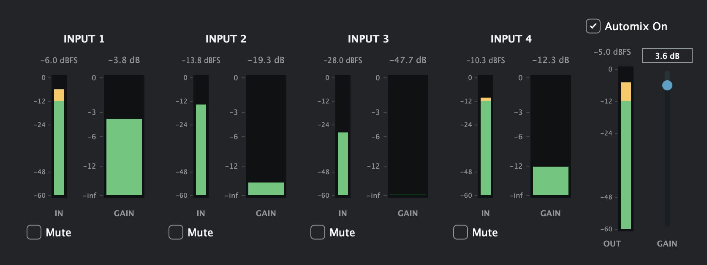

# GainShare Automixer

[](https://github.com/reiddethorne/gainshare-automixer/actions/workflows/build.yml)

A desktop app that automatically balances four microphones. It gives more volume to the person speaking and turns down quieter microphones, then sends the combined mix to both output channels.

I built this project to learn how automatic microphone mixing works and how to process live audio smoothly. It is written in C++17 using JUCE and builds as a standalone app on macOS and Windows.



[Features](#features) · [Build the app](#build-the-app) · [Using the app](#using-the-app) · [Developer guide](docs/DEVELOPMENT.md)

## Features

- Mix four separate microphone inputs into one signal, sent to both outputs.
- Automatically adjust each microphone's volume based on its level relative to the others.
- Name and mute each microphone separately.
- See incoming signal levels and how much gain (volume adjustment) each microphone receives.
- Turn automatic mixing on or off while keeping individual mute controls active.
- Adjust the final output volume from −24 to +6 decibels (dB).
- Recall microphone names, mute settings, automatic mixing, and output volume between runs.

Volume and mute changes fade smoothly to avoid sudden jumps.

## What you need

To use the app with microphones, you need an audio interface with at least **four separate inputs and two outputs**. Both outputs carry the same mono signal; there is no left/right positioning.

To build from source, you also need:

- Git and CMake 3.22 or later.
- **macOS:** Xcode; macOS 12 is the minimum supported version.
- **Windows:** Visual Studio with the **Desktop development with C++** workload.

The repository includes JUCE 9.0.2 as a submodule, a dependency that Git downloads with the command below. Automated tests and offline benchmarks do not require an audio interface.

## Build the app

### 1. Download the source

Open a terminal and run:

```sh
git clone --recurse-submodules https://github.com/reiddethorne/gainshare-automixer.git
cd gainshare-automixer
```

If you already cloned the repository, run `git submodule update --init --recursive` from its folder to download JUCE.

### 2. Build for your platform

Run the following commands from the `gainshare-automixer` folder.

#### macOS

```sh
cmake -S . -B build/macos -G Xcode
cmake --build build/macos --config Release --target GainShareAutomixer_Standalone
```

Open the built app:

```sh
open "build/macos/GainShareAutomixer_artefacts/Release/Standalone/GainShare Automixer.app"
```

To build for both Apple silicon and Intel Macs, add `-DCMAKE_OSX_ARCHITECTURES="arm64;x86_64"` to the configure command (the first command above).

#### Windows

Run these commands in a Visual Studio Developer PowerShell:

```powershell
cmake -S . -B build/windows -A x64
cmake --build build/windows --config Release --target GainShareAutomixer_Standalone
```

Launch the built app:

```powershell
& "./build/windows/GainShareAutomixer_artefacts/Release/Standalone/GainShare Automixer.exe"
```

## Using the app

1. Connect your audio interface and microphones, then launch the app.
2. Open **Options → Audio/MIDI Settings…** and select your interface and its four inputs and two outputs. Allow microphone access if your operating system asks.
3. If the app shows **Audio input is muted to avoid feedback loop**, use **Unmute Input** after checking your monitoring setup. Headphones can help prevent speaker sound from feeding back into the microphones.
4. Speak into each microphone and check the **IN** meters to confirm the input order. Click a microphone's name to edit it.
5. Enable **Automix On** to balance the microphones automatically. The **GAIN** meter on each strip shows the volume adjustment applied to that input. Use **Mute** to exclude a microphone.
6. Adjust the output **GAIN** control while watching the **OUT** meter. Lower the volume if the output clips (reaches or exceeds 0 dBFS, the digital signal ceiling).

Turning off **Automix On** adds the unmuted inputs together without automatic attenuation, so the output may become louder. There is no output limiter to prevent clipping.

## How automatic mixing works

The app measures each microphone's signal power and gives louder inputs a larger share of the total gain. With four equally strong inputs, each receives about a quarter of its original amplitude. When one microphone dominates, its gain approaches full volume.

Muted microphones do not affect the gain assigned to the remaining inputs. The level measurements and gain changes are smoothed so the mix responds gradually.

For the equations and implementation details, see [how the gain sharing works](docs/DEVELOPMENT.md#how-the-gain-sharing-works).

## Tests and performance

The project includes **64 automated DSP (digital signal processing) tests** covering silence, gain sharing, mute, bypass, output volume, matching outputs, and session recall. The 63 signal-processing cases run at three sample rates and three buffer sizes; one additional test checks new and legacy session files.

A separate offline benchmark measures how long audio processing takes. It reports typical timings, slower callbacks, and measurements that exceed the time available for a buffer.

See the developer guide for [running the tests](docs/DEVELOPMENT.md#dsp-tests), [running the benchmark](docs/DEVELOPMENT.md#callback-benchmark), and [interpreting the results](docs/DEVELOPMENT.md#reading-the-benchmark-results).

## Current limitations

- The layout is fixed at four inputs and two outputs carrying the same mix.
- There is no output limiter.
- Reliable live playback with an audio interface and the interface window active still needs manual validation. Offline tests and benchmarks do not establish this.

For a source-file overview, see the [code guide](docs/DEVELOPMENT.md#code-guide).
